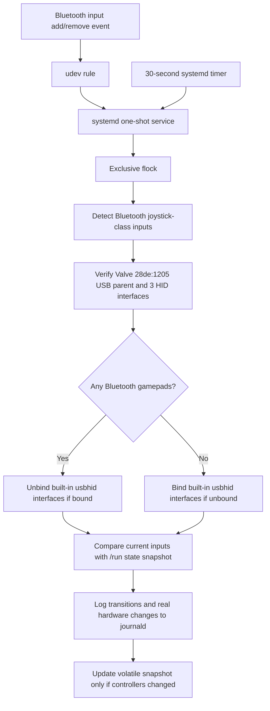

# Architecture and decisions

## Roles

| Component | Responsibility |
| --- | --- |
| `controller_fix.py` | Enumerate inputs, verify USB identities, reconcile HID state, emit useful logs |
| `92-steamdeck-controller-fix.rules` | Notify systemd on input `event*` add/remove |
| `.service` | Short, root-owned one-shot with short settling delay |
| `.timer` | Reconcile at boot and every 30 seconds if an event was missed |
| `/run/steamdeck-controller-fix.lock` | Kernel `flock` keeps simultaneous invocations serialized |
| `/run/steamdeck-controller-fix/state.json` | Volatile snapshot for meaningful connected/disconnected logs |
| `install.sh` | SteamOS preflight, install or recognized in-place upgrade, optional keep-list |
| `uninstall.sh` | Stop automation, restore built-in controls, clean up owned files |

## Logging contract

At default `INFO` level, a no-change poll emits **zero messages from the script**. The systemd manager still records service start/stop activity; `journalctl -t steamdeck-controller-fix` filters to actual script messages. On the first successful reconciliation after boot, emit one `startup`. Device changes are diffed using VID, PID, displayed name and input sysname; a second controller can connect while built-in controls remain disabled, and the connection still gets logged. A sysfs binding operation is logged only **after its write succeeds**. Errors return nonzero to systemd. The cache is written after successful operations, not before.

`restore` is deliberately temporary: it makes the internal HID interfaces available for recovery, but the next automatic reconciliation resumes normal policy. `uninstall` stops the timer/udev rule first.

## Why not a resident daemon?

One-shot execution minimizes always-running processes and dependencies. The timer handles missed events. The cache in `/run` provides event-style logs without constant writes to persistent storage.

## Out of scope

Game-specific player-order logic, wired controller detection, an on-device GUI, custom Bluetooth pairing logic, and arbitrary unknown Steam Deck hardware layouts. Expanding hardware support requires a separately reviewed hardware preflight and physical-device testing.
